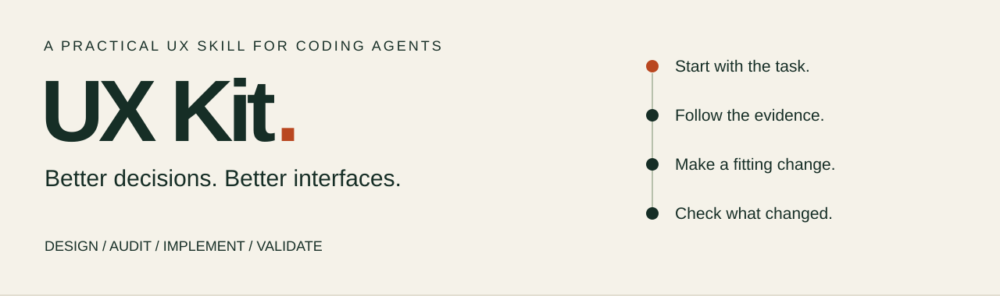

<p align="center"></p>

<p align="center"><strong>Practical UX judgment for AI coding agents.</strong><br>Open source · MIT · Experimental</p>

<p align="center"><a href="#install">Install</a> · <a href="#see-the-difference">See an example</a> · <a href="docs/public/coverage.md">Explore coverage</a> · <a href="docs/public/evidence.md">Evidence & limits</a> · <a href="CONTRIBUTING.md">Contribute</a></p>

UX Kit helps your agent decide **what needs to change, what should stay, and how to check the result**. Use it to design a flow, audit an existing feature, implement an authorized fix, or validate a proposed improvement across web and native mobile interfaces.

It connects the user's task to evidence, a fitting UX principle, a concrete intervention and a regression check. The aim is a more usable product with its identity and useful behavior intact.

> **Experimental source preview.** Installation and focused checks are available. Public beta and stable quality gates remain unmet. Read [what has been verified](docs/public/evidence.md) before relying on a recommendation for consequential product work.

## Install

From your project directory, using Node.js/npm:

```sh
npx skills@1.7.4 add flklr-dev/ux-kit --skill ux-kit -a codex --copy
```

Then ask your agent:

```text
Use UX Kit to audit this feature. Identify the most important usability
problems supported by the evidence, preserve what works, and give concrete
recommendations and checks. Do not edit files.
```

For a Claude Code project, use `-a claude-code`. Installation from GitHub was verified in new Windows projects for both agents, with all 176 skill files matching the public source. Claude's native task execution remains unverified. Codex explicit loading has prior local evidence. [Installation, manual copy and compatibility](docs/public/installation.md)

Ordinary use needs no UX Kit runtime, API key, account or server. An agent can still need its own tools or network access to inspect your app or verify a changing source.

## See the difference

A checkout shows **$19.00 in items**, a selected **$4.99 Express upgrade**, and two unresolved fees.

| Decision | UX Kit's approach |
|---|---|
| What is the problem? | A person cannot yet know the complete payable amount. |
| What should stay? | Recognizable items, editable quantities, compact delivery choices and familiar copy. |
| What should change? | Show **Subtotal $23.99**, name the missing fees, and reveal the complete total before commitment. |
| What needs checking? | Change delivery/quantity, delay fee loading, retry a failure, and verify the same entered details survive. |

The next button's label follows its actual effect. A review step is proposed only when the flow needs one. More whitespace, fewer controls or a longer label is not automatically a UX improvement.

**Try the executable [BasketBay demo](examples/interactive-basketbay/README.md)**: quantity changes, promo correction, optional repeat setup, simulated failures and retry. Its fees and policies are illustrative. Six model tests and 14 browser checks passed after review corrections; no real payment or human-study result is implied.

## Four ways to use it

| Mode | Ask for | Get |
|---|---|---|
| **Design** | “Design a permission request with denial and fallback.” | A proposed journey, states, tradeoffs and checks. |
| **Audit** | “Review this checkout; preserve what works.” | A few prioritized findings with evidence and confidence. |
| **Implement** | “Fix this authorized form error using our components.” | Scoped changes and verification. |
| **Validate** | “Does this retry fix preserve pending edits?” | The original problem compared with the observed result. |

Audit and design requests do not authorize product edits. UX Kit follows the host's permissions and your scope.

## A library for decisions, not a list to apply everywhere

**137 canonical entries · 15 topic guides · 12 feature guides**

The library spans choice and cognition, Gestalt grouping, targeting, learning, navigation, forms, commerce, expert data tools, copy, accessibility, native resilience, AI review and research methods. All 30 mapped Laws of UX concepts are addressed with conditions, qualifications or merged aliases.

Each entry explains **when it helps, when it does not, what conflicts with it, and how to check it**. Standards, platform conventions, heuristics, patterns and methods keep their own evidence boundaries. Five navigation items is not a universal psychological limit; useful expert complexity can be worth keeping.

[Browse coverage](docs/public/coverage.md) · [Read the skill](skills/ux-kit/SKILL.md) · [Inspect source traceability](skills/ux-kit/references/source-registry.json)

## Fits your product

- Keep the existing stack, design system, useful imagery, familiar labels and working routes.
- Review empty, loading, error, offline, interrupted and partial-result states where relevant.
- Separate directly observed behavior from source inspection and hypotheses.
- Give severity and confidence separately; avoid arbitrary overall UX scores.
- Check changed tasks and retained tasks. A still image cannot prove keyboard, network or recovery behavior.

UX Kit complements art-direction, visual-design and engineering-process skills. It does not guarantee that another skill, model or generated interface will follow every recommendation.

## What we can honestly claim today

The payload is structured, portable and locally installable. Focused development checks and the BasketBay example show useful results, alongside retained failures and strong-control ties. The owner reports that BasketBay improved.

Broad superiority, token efficiency, conversion gains, universal compatibility and full accessibility conformance are **not established**. A larger principle library is coverage, not proof of effectiveness. [Evidence, tested matrix and known limitations](docs/public/evidence.md)

## Help make it better

A useful issue names the task, evidence, consequence and a reproducible check. A useful principle includes a counterexample and an honest limit. Sanitized failures are especially welcome.

[Contribution guide](CONTRIBUTING.md) · [Report a problem](https://github.com/flklr-dev/ux-kit/issues/new/choose) · [Release checklist](docs/public/release-checklist.md)

Licensed under [MIT](LICENSE). The installed skill includes its own license copy. Linked third-party sources retain their original rights.
